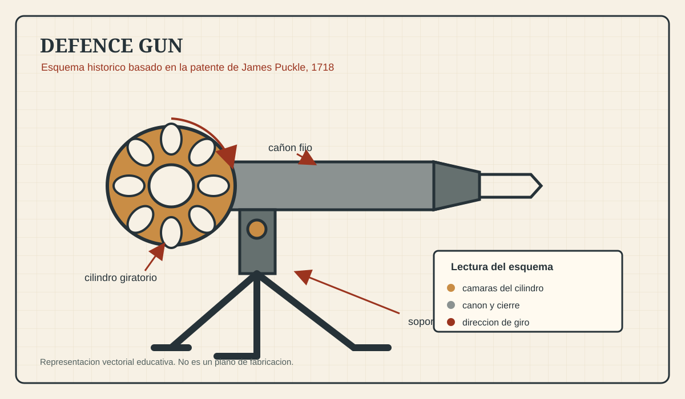

# Diagramas de la patente «Defence Gun»

Proyecto histórico y educativo dedicado a estudiar visualmente la **Defence Gun**, un arma de repetición patentada por **James Puckle en 1718**. El repositorio reúne distintas representaciones del diseño en formatos SVG, Excalidraw y Mermaid, además de un proyecto de vídeo explicativo.

## Imagen histórica de la patente

La siguiente ilustración histórica muestra el diseño atribuido a la patente de James Puckle y las variantes de cilindros para distintos tipos de munición. La imagen está alojada en Wikimedia Commons y se identifica como de dominio público en Estados Unidos.

<p align="center">
  
</p>

Fuente y datos de la imagen: [Wikimedia Commons — Puckle gun advertisement.jpg](https://commons.wikimedia.org/wiki/File:Puckle_gun_advertisement.jpg).

## Diagrama del proyecto

Esta es la representación esquemática desarrollada en este repositorio; no es una reproducción exacta del documento original.

<p align="center">
  
</p>

## Objetivo del proyecto

Presentar de forma clara y comparable los elementos principales que aparecen en la interpretación visual de la patente:

- Cañón y soporte.
- Cilindro giratorio con varias cámaras.
- Mecanismo de giro y carga, representado de forma esquemática.
- Montaje sobre soporte y trípode.
- Secuencia conceptual de funcionamiento.

El contenido tiene un propósito **histórico, visual y educativo**. Los diagramas son esquemáticos y no deben interpretarse como planos de fabricación ni como una reproducción exacta de un arma histórica.

## Contenido del repositorio

### 1. Diagrama SVG

Ilustración vectorial que se puede visualizar en el navegador y ampliar sin perder nitidez.

**Archivo:** [`defenseGun.svg`](defenseGun.svg)

### 2. Diagrama editable de Excalidraw

Versión de estilo pizarra que permite reorganizar elementos, añadir anotaciones y explicar las relaciones visuales.

**Archivo:** [`defenseGun.excalidraw`](defenseGun.excalidraw)

Puedes abrirlo con [Excalidraw](https://excalidraw.com/) o una aplicación compatible.

### 3. Diagrama Mermaid

Esquema conceptual de los componentes principales. Utiliza una paleta sepia inspirada en los grabados técnicos históricos; su disposición es ilustrativa y no está a escala.

**Archivo:** [`defenseGun.mmd`](defenseGun.mmd)

Para visualizarlo, utiliza [Mermaid Live Editor](https://mermaid.live/) y pega el contenido del archivo.

### 4. Vídeo vertical

El repositorio incluye un proyecto de vídeo animado sobre la patente y su contexto histórico.

**Carpeta:** [`puckle-vertical-video/`](puckle-vertical-video/)

Para abrir la vista previa:

```bash
cd puckle-vertical-video
npm install
npm run dev
```

En Remotion Studio, selecciona la composición `PuckleVertical`. Consulta el [README del proyecto de vídeo](puckle-vertical-video/README.md) para ver los pasos de exportación.

### 5. Documentación

En la carpeta [`docs/`](docs/) se guardan materiales de apoyo, como el guion y el audio del proyecto, cuando están disponibles.

## Contexto histórico

En 1718, James Puckle patentó un diseño de arma montada con un cilindro giratorio que buscaba permitir disparos sucesivos sin recargar manualmente el cañón después de cada disparo. La patente describía variantes de munición, incluidas balas redondas y una propuesta de balas cuadradas.

Este proyecto interpreta visualmente el concepto para facilitar su comprensión. Para consultar detalles históricos, conviene contrastar la representación con una reproducción o transcripción de la patente original.

## Estructura del proyecto

```text
Diagramas/
├── README.md
├── AGENTS.md
├── defenseGun.svg
├── defenseGun.excalidraw
├── defenseGun.mmd
├── docs/
├── puckle-vertical-video/
└── version_2/
```

La estructura puede ampliarse a medida que se incorporen nuevos materiales o versiones. No se deben eliminar carpetas ni archivos existentes.

## Herramientas utilizadas

- **SVG:** ilustración vectorial.
- **Excalidraw:** diagrama editable.
- **Mermaid:** diagramas mediante texto.
- **Remotion:** composición y renderizado del vídeo.
- **GitHub:** control de versiones y documentación del proyecto.

## Alcance y precisión

Las ilustraciones simplifican algunos detalles para mejorar la lectura y no sustituyen el documento histórico original. La ilustración externa se enlaza desde Wikimedia Commons; la representación SVG es parte de este repositorio.

## Créditos y uso

Proyecto académico de documentación visual sobre la patente de James Puckle de 1718. La ilustración histórica se atribuye a Wikimedia Commons; consulta su [página de archivo](https://commons.wikimedia.org/wiki/File:Puckle_gun_advertisement.jpg) para revisar sus metadatos y condiciones de reutilización.
